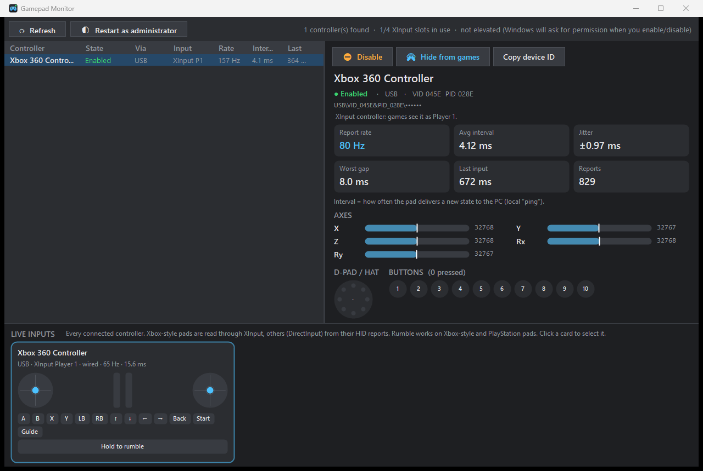

<p align="center">
  
</p>

<h1 align="center">Gamepad Monitor</h1>

<p align="center">
  See every game controller on your Windows PC, test it live, measure its report rate ("ping"),<br>
  and switch it off or hide it from games in one click, without unplugging it.
</p>



## Features

- **Every controller in one list.** Xbox 360 / One / Series pads, PlayStation DualShock 4 and DualSense, Switch Pro, generic USB/Bluetooth gamepads, joysticks and wheels, and virtual pads (ViGEm, DS4Windows, Steam).
- **Connection type.** USB, Bluetooth, Bluetooth LE, Xbox wireless receiver/adapter, or virtual.
- **Input type.** Shows whether games see the pad as **XInput** (and which player slot, P1–P4) or **DirectInput / HID**.
- **Report rate ("ping").** How often the controller sends a new state: Hz, average interval in ms, jitter, worst gap and time since the last input.
- **Live input test.** Sticks, triggers, D-pad and every button light up as you press them, for all controllers at once, plus the raw HID report.
- **Rumble test.** For Xbox-style pads (via XInput) and PlayStation DualShock 4 / DualSense (USB and Bluetooth).
- **Disable / Enable at the driver level.** Same as Device Manager: the controller disappears from every game and app. If programs are holding a USB pad open, the app **replugs it in software** so the change happens right away, with no physical unplugging.
- **Hide from games (optional, needs [HidHide](https://github.com/nefarius/HidHide)).** Hides a controller from all games and apps while keeping it switched on, so Gamepad Monitor can still show its inputs.
- **Explains blocked changes.** When Windows can't switch a controller off, the app lists which programs are holding it, taken from Windows' own event log.

## Download and install

1. Go to the [**latest release**](../../releases/latest).
2. Download **`GamepadMonitor-<version>-win-x64.zip`**.
3. Right-click the zip, choose **Extract All…**, and pick a folder to keep it in (for example `C:\Apps\GamepadMonitor`).
4. Double-click **`GamepadMonitor.exe`**.

That's it: no installer, and nothing else to install.

**Optional:**
- **Start menu / taskbar:** right-click `GamepadMonitor.exe` → **Show more options** → **Pin to Start** or **Pin to taskbar**.
- **No admin prompts:** Disable, Enable, Replug and Hide need administrator rights, so Windows asks each time. To skip the prompts, right-click the exe (or your shortcut) → **Properties** → **Compatibility** → tick **Run this program as an administrator**.
- **Smaller download:** if you already have the [.NET 9 Desktop Runtime](https://dotnet.microsoft.com/download/dotnet/9.0) installed, download **`GamepadMonitor-<version>-win-x64-small.zip`** instead (about 0.2 MB instead of about 43 MB).

> **Windows SmartScreen:** the app isn't code-signed, so the first time you run it Windows may show *"Windows protected your PC"*. Click **More info** → **Run anyway**. You can check the download against the SHA-256 hashes listed on the release page.

### Optional: HidHide (for "Hide from games")

1. Install HidHide from its [official releases page](https://github.com/nefarius/HidHide/releases/latest) and restart if it asks you to.
2. In Gamepad Monitor, select a controller and click **Hide from games**.

Gamepad Monitor adds itself to HidHide's allow-list automatically, so hidden controllers still show up in the app.

**Requirements:** Windows 10 or 11, 64-bit.

## How to use

| Button | What it does |
|---|---|
| **Disable / Enable** | Turns the controller off or on at the driver level, like Device Manager. The setting survives reboots. |
| **⟲ Replug now** | Appears only when a change is stuck. Power-cycles the controller's USB port to finish the change. |
| **Hide from games / Show to games** | With HidHide installed: hides the controller from everything except this app, without turning it off. |
| **Hold to rumble** | Vibrates the controller for as long as you hold the button. |
| **Restart as administrator** | Restarts the app with admin rights so the buttons above don't prompt each time. |

### Things worth knowing

- **0 Hz when idle is normal for Xbox pads.** They only send a report when something changes. Move a stick to measure them. PlayStation pads report all the time.
- **"Disable pending":** XInput lets programs (Steam, Discord, Game Bar, game engines…) hold Xbox-style pads open, and Windows then can't stop the pad immediately. For a USB pad the app finishes the change by replugging it in software. For a Bluetooth pad, turn the controller off and on. You never need to restart the PC.
- **Bluetooth PlayStation rumble:** the first rumble command switches a Bluetooth DualShock 4 / DualSense into its "extended" mode. Until you turn the controller off and on, games that read it through plain DirectInput may stop seeing its buttons; Steam and DS4Windows are fine. The app warns you before the first time.
- **Different USB port = new device.** Windows remembers *disabled* per USB port or Bluetooth pairing. Plugging a disabled pad into a different port can make it show up as a new, enabled device.

## Build from source

You need the [.NET 9 SDK](https://dotnet.microsoft.com/download/dotnet/9.0).

```powershell
git clone https://github.com/Kudoshi/gamepad-monitor.git
cd gamepad-monitor\GamepadMonitor
dotnet run -c Release
```

Build the release packages:

```powershell
# Self-contained single exe (no .NET install needed to run it)
dotnet publish GamepadMonitor -c Release -r win-x64 --self-contained true -p:PublishSingleFile=true -p:IncludeNativeLibrariesForSelfExtract=true -p:EnableCompressionInSingleFile=true -o dist\full

# Small exe that uses the installed .NET 9 Desktop Runtime
dotnet publish GamepadMonitor -c Release -r win-x64 --self-contained false -p:PublishSingleFile=true -o dist\small
```

For a plain-text diagnostics report of everything the app detects, run:

```powershell
GamepadMonitor.exe --dump report.txt
```

## How it works

| Part | Windows API |
|---|---|
| Device list and connection type | Configuration Manager (`cfgmgr32`): walks each controller's device tree up to its bus (USB hub, Bluetooth, virtual). |
| HID input | Raw Input with `RIDEV_INPUTSINK`, decoded with the HID parser (`HidP_*`). Hidden controllers are read directly with `ReadFile`. |
| XInput | `xinput1_4.dll`, polled every millisecond. The undocumented `XInputGetStateEx` is used for the Guide button. |
| Rumble | `XInputSetState` for Xbox pads; Sony output reports (with CRC32 over Bluetooth) for DualShock 4 / DualSense. |
| Enable / disable | SetupAPI `DIF_PROPERTYCHANGE`, the same call Device Manager uses. |
| Software replug | `IOCTL_USB_HUB_CYCLE_PORT` on the controller's USB hub port. |
| Blocking programs | Kernel-PnP event 225 in the System event log. Only program names are shown, never command lines. |
| Hide from games | HidHide's `HidHideCLI.exe`. |

## License

[MIT](LICENSE)
